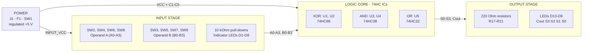
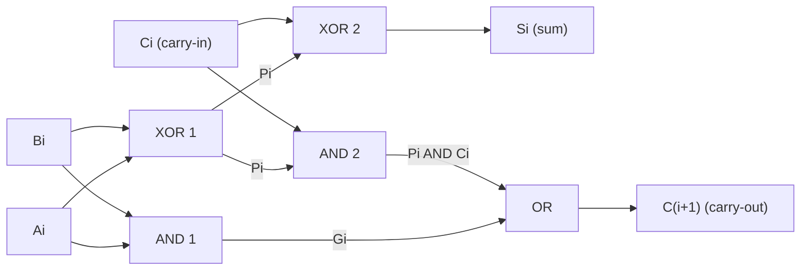
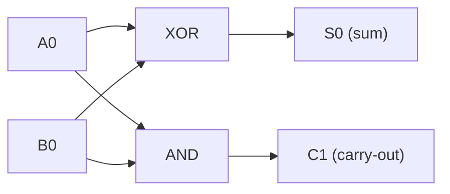
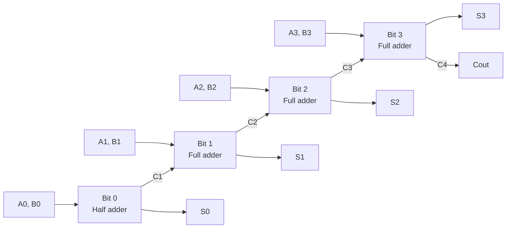
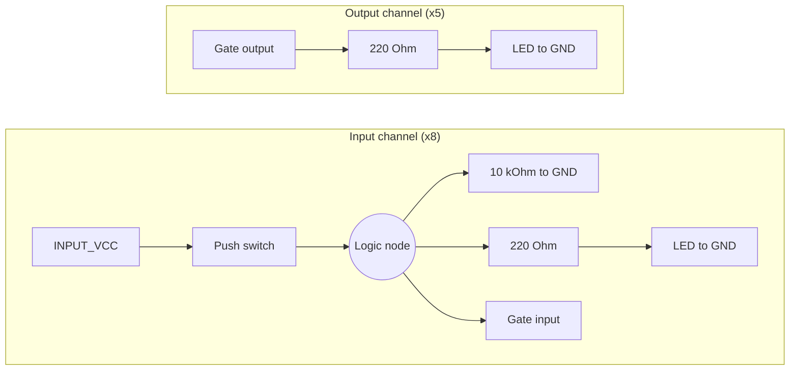
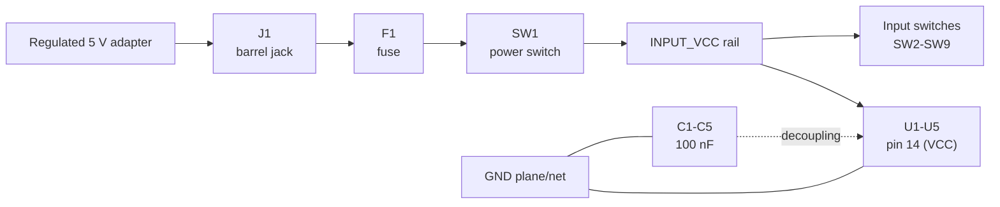

# 4-Bit Binary Adder Using 74HC Logic ICs

A through-hole, discrete-logic **4-bit ripple-carry adder** built from 74HC86 (XOR), 74HC08 (AND) and 74HC32 (OR) ICs, with push-button inputs, LED indicators and a PCB designed in **KiCad**.


> **Project status:** The schematic and final PCB layout are complete in KiCad. This README makes **no claim** that the board has been fabricated, assembled or tested. All results below are *theoretical expected values*. Items marked **⚠ Confirm** should be checked before fabrication.

## At a Glance

| Parameter | Specification |
|---|---|
| Function | Adds two 4-bit unsigned binary numbers |
| Inputs | 8 push switches: A0–A3 and B0–B3 |
| Output | 5-bit result `Cout S3 S2 S1 S0` (range 0 to 30) on 5 LEDs |
| Architecture | Half adder (bit 0) + three full adders (bits 1–3), ripple-carry |
| Logic ICs | 2× 74HC86 (XOR), 2× 74HC08 (AND), 1× 74HC32 (OR) |
| Supply | Regulated 5 V DC via barrel jack, fuse and power switch |
| PCB | KiCad, through-hole, appears to be 2-layer |
| Hardware status | Fabrication and testing **not yet verified** |


---

## Table of Contents

1. [Introduction](#1-introduction)
2. [Project Overview](#2-project-overview)
3. [Key Features](#3-key-features)
4. [Objectives and Learning Outcomes](#4-objectives-and-learning-outcomes)
5. [Working Principle of a 4-Bit Binary Adder](#5-working-principle-of-a-4-bit-binary-adder)
6. [Boolean Expressions and Logic Equations](#6-boolean-expressions-and-logic-equations)
7. [Circuit Architecture and Block Diagram](#7-circuit-architecture-and-block-diagram)
8. [Hardware Components](#8-hardware-components)
9. [Input and Output Explanation](#9-input-and-output-explanation)
10. [Circuit Operation: Worked Example](#10-circuit-operation-worked-example)
11. [Expected Output and Verification Test Cases](#11-expected-output-and-verification-test-cases)
12. [Power Supply Requirements and Safety Precautions](#12-power-supply-requirements-and-safety-precautions)
13. [PCB Design Details and KiCad Files](#13-pcb-design-details-and-kicad-files)
14. [Repository Folder Structure](#14-repository-folder-structure)
15. [How to Open the Project in KiCad](#15-how-to-open-the-project-in-kicad)
16. [Testing and Troubleshooting](#16-testing-and-troubleshooting)
17. [Applications](#17-applications)
18. [Limitations and Possible Future Improvements](#18-limitations-and-possible-future-improvements)
19. [Skills Demonstrated](#19-skills-demonstrated)
20. [Author and Acknowledgements](#20-author-and-acknowledgements)

---

## 1. Introduction

Adders are the foundation of every arithmetic logic unit (ALU). This project implements a 4-bit binary adder **using only basic logic gates** (XOR, AND, OR) instead of a ready-made adder IC such as the 74HC283. Building it gate by gate makes the carry mechanism visible and testable on real hardware.

## 2. Project Overview

The circuit adds two 4-bit unsigned numbers, **A (A3 A2 A1 A0)** and **B (B3 B2 B1 B0)**, entered with eight push switches. The result is a **5-bit value** shown on five LEDs:

```
Result = Cout S3 S2 S1 S0
```

- **S0–S3** are the four sum bits (S0 = LSB).
- **Cout** is the final carry out of bit 3 and acts as the fifth (most significant) result bit.

The maximum result is 1111 + 1111 = 11110 (15 + 15 = 30), which needs 5 bits.

The board also has eight **input-indicator LEDs** (D1–D8) that mirror the state of each input switch, plus five **output LEDs** (D9–D13).

## 3. Key Features

- Pure gate-level design: 2× 74HC86, 2× 74HC08, 1× 74HC32.
- Two 4-bit inputs, 5-bit output (sum + carry).
- Input-state LEDs for each switch, so the entered operands can be read directly from the board.
- 10 kΩ pull-down resistors for defined logic-low inputs.
- Five 100 nF decoupling capacitors (C1–C5), one beside each IC.
- 220 Ω series resistors on every LED.
- Power entry through a barrel jack with a fuse and an on/off switch.
- Through-hole, breadboard-style parts, easy to hand-solder and probe.
- Silkscreen reference table for 4-bit values 0–15 on the board.
- Complete KiCad schematic and 2-layer PCB layout.

## 4. Objectives and Learning Outcomes

**Objectives**

- Design a multi-bit adder from XOR, AND and OR gates.
- Translate a schematic into a PCB layout using KiCad.
- Add clear user interface elements (switches, LEDs, silkscreen) to a logic board.

**Learning outcomes**

- Derive half-adder and full-adder equations and cascade them.
- Understand ripple-carry propagation and its speed limitation.
- Understand CMOS logic practice: pull-downs, unused-input handling, decoupling and LED current limiting.
- Practice schematic capture, footprint assignment, routing, DRC and design documentation.

## 5. Working Principle of a 4-Bit Binary Adder

Binary addition works like decimal addition, column by column, from the least significant bit (LSB) to the most significant bit (MSB). In each column we add two input bits plus the carry coming from the previous column.

| Building block | Inputs | Outputs | Used for |
|---|---|---|---|
| **Half adder** | A, B | Sum, Carry | Bit 0 (no carry-in) |
| **Full adder** | A, B, Cin | Sum, Cout | Bits 1, 2, 3 |

**Ripple-carry principle.** The carry-out of each stage feeds the carry-in of the next stage:

```
C0 = 0 → [Bit 0] → C1 → [Bit 1] → C2 → [Bit 2] → C3 → [Bit 3] → C4 = Cout
```

Bit *i* cannot produce a valid sum until the carry from bit *i−1* has settled. The carry therefore "ripples" from the LSB to the MSB. The worst case (e.g. `1111 + 0001`) makes the carry travel through all four stages, which is why the delay grows with word length.

## 6. Boolean Expressions and Logic Equations

For each bit *i*, define the **propagate** signal $P_i$ and **generate** signal $G_i$:

$$P_i = A_i \oplus B_i \qquad G_i = A_i \cdot B_i$$

**Bit 0 (half adder, $C_0 = 0$):**

$$S_0 = A_0 \oplus B_0 \qquad C_1 = A_0 \cdot B_0$$

**Bits 1 to 3 (full adder):**

$$S_i = A_i \oplus B_i \oplus C_i = P_i \oplus C_i$$

$$C_{i+1} = A_i B_i + (A_i \oplus B_i)\,C_i = G_i + P_i C_i$$

**Final carry (fifth output bit):**

$$C_{out} = C_4$$

**Gate budget (derived from the equations):**

| Gate type | Needed | Available (ICs fitted) | Spare |
|---|---|---|---|
| XOR (74HC86) | 7 | 8 (2 ICs) | 1 |
| AND (74HC08) | 7 | 8 (2 ICs) | 1 |
| OR (74HC32) | 3 | 4 (1 IC) | 1 |

Gate truth tables:

| A | B | XOR (A⊕B) | AND (A·B) | OR (A+B) |
|:-:|:-:|:-:|:-:|:-:|
| 0 | 0 | 0 | 0 | 0 |
| 0 | 1 | 1 | 0 | 1 |
| 1 | 0 | 1 | 0 | 1 |
| 1 | 1 | 0 | 1 | 1 |

## 7. Circuit Architecture and Block Diagram

### 7.1 System-level block diagram

The design is split into four functional blocks: **power**, **input stage**, **logic core** and **output stage**.



### 7.2 Functional blocks

| Block | Reference designators | Function | Key signals |
|---|---|---|---|
| **Power** | J1, F1, SW1, C1–C5 | Accepts regulated 5 V DC, protects with a fuse, switches the supply, decouples each IC | `INPUT_VCC`, `GND` |
| **Input stage** | SW2–SW9, R2/R3/R5/R7/R9/R11/R13/R15, D1–D8, R1/R4/R6/R8/R10/R12/R14/R16 | Converts switch positions into clean logic levels and shows each level on an LED | A0–A3, B0–B3 |
| **XOR section** | U1, U2 (74HC86) | Computes propagate signals $P_i$ and sum bits $S_i$ | $P_i$, $S_i$ |
| **AND section** | U3, U4 (74HC08) | Computes generate signals $G_i$ and carry-propagate terms $P_i C_i$ | $G_i$, $P_i C_i$ |
| **OR section** | U5 (74HC32) | Combines $G_i$ and $P_i C_i$ into the next carry | $C_{i+1}$ |
| **Output stage** | R17–R21, D9–D13 | Displays S0–S3 and Cout | `Cout S3 S2 S1 S0` |

### 7.3 Bit-slice architecture

The adder is built from four identical bit slices. Bit 0 has no carry-in, so it needs only a **half adder**. Bits 1 to 3 each use a **full adder** made from two XOR gates, two AND gates and one OR gate.

**Full-adder slice (bits 1–3):**



**Half-adder slice (bit 0):**



### 7.4 Gate allocation per stage

| Stage | Type | XOR | AND | OR | Outputs |
|---|---|:-:|:-:|:-:|---|
| Bit 0 | Half adder | 1 | 1 | 0 | S0, C1 |
| Bit 1 | Full adder | 2 | 2 | 1 | S1, C2 |
| Bit 2 | Full adder | 2 | 2 | 1 | S2, C3 |
| Bit 3 | Full adder | 2 | 2 | 1 | S3, C4 = Cout |
| **Required** | | **7** | **7** | **3** | |
| **Available** (2× 74HC86, 2× 74HC08, 1× 74HC32) | | 8 | 8 | 4 | |
| **Spare** | | 1 | 1 | 1 | Unused inputs must be tied to a defined level |

The exact gate-to-pin assignment is defined in the KiCad schematic and is not repeated here.

### 7.5 Ripple-carry chain

The carry-out of each slice drives the carry-in of the next one. The fifth result bit, Cout, is the carry-out of bit 3.



### 7.6 Signal timing (derived from topology)

Counting the number of gates a signal passes through gives the **logic depth**. Assuming all inputs change at the same instant:

| Signal | Path | Depth (gate delays) |
|---|---|:-:|
| S0, C1 | XOR or AND of A0, B0 | 1 |
| S1 | XOR(P1, C1) | 2 |
| C2 | AND(P1, C1) → OR with G1 | 3 |
| S2 | XOR(P2, C2) | 4 |
| C3 | AND(P2, C2) → OR with G2 | 5 |
| S3 | XOR(P3, C3) | 6 |
| **Cout (C4)** | AND(P3, C3) → OR with G3 | **7** |

Each ripple stage adds two gate delays (one AND plus one OR) to the carry path, so the worst case is `1111 + 0001`. These depths come from the circuit structure, **not from measurement**; actual propagation delay depends on the 74HC datasheet values, supply voltage and load.

### 7.7 Input and output channel structure

Each of the eight inputs and five outputs uses the same circuit pattern.



| Channel | Idle state | Active state | Notes |
|---|---|---|---|
| Input | Pulled to GND by 10 kΩ (logic 0), LED off | Switch connects node to `INPUT_VCC` (logic 1), LED on | Switch type (latching or momentary) to be confirmed |
| Output | Gate output low, LED off | Gate output high, LED on (active-high) | LED current set by the 220 Ω series resistor |

### 7.8 Power distribution



The same `INPUT_VCC` rail powers the ICs and provides the logic-high level for the input switches. There is no on-board regulator, so the adapter must supply a regulated 5 V (see [Section 12](#12-power-supply-requirements-and-safety-precautions)).

### 7.9 Physical placement versus logical function

| PCB area | Contents | Logical role |
|---|---|---|
| Top row, left to right | U1 (XOR-1), U3 (AND-1), U5 (OR), U4 (AND-2), U2 (XOR-2), with C1–C5 between them | Logic core |
| Middle left (two rows of four) | SW2, SW4, SW6, SW8 / SW3, SW5, SW7, SW9 | Operand entry |
| Middle right (framed array) | D1–D8 | Input-state indicators |
| Bottom of LED frame | D13 D12 D11 D10 D9 | Output: Cout S3 S2 S1 S0 (left to right) |
| Bottom left | J1, F1, SW1 | Power entry |
| Bottom centre | 10 kΩ bank (R2, R3, R5, R7, R9, R11, R13, R15) and 220 Ω bank (R1, R4, R6, R8, R10, R12, R14, R16–R21) | Pull-downs and LED current limiting |

## 8. Hardware Components

Quantities are taken from the KiCad schematic and PCB silkscreen.

| Ref. | Component | Qty | Purpose |
|---|---|:-:|---|
| U (×2) | 74HC86, quad 2-input XOR, DIP-14 | 2 | Sum bits and propagate signals |
| U (×2) | 74HC08, quad 2-input AND, DIP-14 | 2 | Generate and propagate-carry terms |
| U (×1) | 74HC32, quad 2-input OR, DIP-14 | 1 | Combines carry terms |
| SW2–SW9 | DPDT push switch (`SW_Push_DPDT` symbol) | 8 | Enter A3–A0 and B3–B0 |
| D1–D8 | LED | 8 | Show the state of each input |
| D9–D13 | LED | 5 | Display S0–S3 and Cout |
| R2, R3, R5, R7, R9, R11, R13, R15 | 10 kΩ resistor | 8 | Input pull-downs |
| R1, R4, R6, R8, R10, R12, R14, R16 | 220 Ω resistor | 8 | Current limit for input LEDs |
| R17–R21 | 220 Ω resistor | 5 | Current limit for output LEDs |
| J1 | DC barrel jack | 1 | 5 V supply input |
| F1 | Small fuse | 1 | Overcurrent protection (**⚠ Confirm rating**) |
| SW1 | Slide power switch | 1 | Supply on/off |
| H1, H2 | Mounting holes | 2 | Mechanical mounting (**⚠ Confirm size**) |
| C1–C5 | 100 nF ceramic decoupling capacitor | 5 | Local supply decoupling, one beside each IC |
| *C (optional)* | 10–100 µF electrolytic bulk capacitor | 1 | **Not in the current design.** Recommended near J1 (hand-fit or add in a future revision) |

Optional: DIP-14 IC sockets (recommended for easy IC replacement).

Total: 5 ICs, 8 switches, 13 LEDs, 8× 10 kΩ resistors, 13× 220 Ω resistors and 5× 100 nF capacitors.

## 9. Input and Output Explanation

### Inputs

| Operand bit | Switch | Schematic net | Weight |
|---|---|---|:-:|
| A0 | SW2 | A1 | 2⁰ |
| B0 | SW3 | B1 | 2⁰ |
| A1 | SW4 | A2 | 2¹ |
| B1 | SW5 | B2 | 2¹ |
| A2 | SW6 | A3 | 2² |
| B2 | SW7 | B3 | 2² |
| A3 | SW8 | A4 | 2³ |
| B3 | SW9 | B4 | 2³ |

> **⚠ Confirm:** The schematic names the bit pairs A1/B1 … A4/B4, while this README uses A0–A3 and B0–B3 (standard LSB = bit 0 notation). The mapping above assumes "Input-1" is the least significant pair. Verify against the netlist.

Each switch connects its signal node to `INPUT_VCC` (logic 1) when actuated; a 10 kΩ pull-down holds the node at GND (logic 0) otherwise. An LED with a 220 Ω resistor on the same node shows the current logic level. **⚠ Confirm** whether the chosen switch is latching or momentary, since this determines how operands are held.

### Outputs

| LED | Meaning | Schematic net (assumed) |
|---|---|---|
| D13 | **Cout** (MSB, bit 4) | `OR_Y4` |
| D12 | S3 | `4OUT` |
| D11 | S2 | `3OUT` |
| D10 | S1 | `2OUT` |
| D9 | S0 (LSB) | `1OUT` |

Read the output LEDs left to right on the PCB as **D13 D12 D11 D10 D9 = Cout S3 S2 S1 S0**.

> **⚠ Confirm:** The schematic annotations label `1OUT` as "Bit-1 (MSB)" and `OR_Y4` as "Bit-5 (LSB)". By the adder equations, `1OUT` should be the LSB sum and the final OR output should be Cout (MSB), so those annotations look reversed. Correct the schematic text or the net assignments so documentation and hardware agree.

## 10. Circuit Operation: Worked Example

**Example:** `1111 + 0001` (15 + 1 = 16)

A = 1111 (A3 A2 A1 A0), B = 0001 (B3 B2 B1 B0)

| Stage | Ai | Bi | Cin | Pi = Ai⊕Bi | Si = Pi⊕Cin | Gi = Ai·Bi | Pi·Cin | Cout(i) = Gi + Pi·Cin |
|:-:|:-:|:-:|:-:|:-:|:-:|:-:|:-:|:-:|
| Bit 0 | 1 | 1 | 0 (none) | 0 | **0** | 1 | 0 | **1** |
| Bit 1 | 1 | 0 | 1 | 1 | **0** | 0 | 1 | **1** |
| Bit 2 | 1 | 0 | 1 | 1 | **0** | 0 | 1 | **1** |
| Bit 3 | 1 | 0 | 1 | 1 | **0** | 0 | 1 | **1** |

Final carry out = 1, so:

```
    1 1 1 1     (A = 15)
  + 0 0 0 1     (B =  1)
  ---------
  1 0 0 0 0     → Cout S3 S2 S1 S0 = 1 0 0 0 0 = 16
```

Expected LED state: **D13 ON**, D12, D11, D10, D9 OFF. The carry created at bit 0 ripples through bits 1, 2 and 3 before appearing as Cout.

## 11. Expected Output and Verification Test Cases

> All values below are **theoretical**. The "Result on hardware" column is intentionally blank until real testing is done.

| # | Category | A (A3..A0) | B (B3..B0) | Expected Cout S3 S2 S1 S0 | Decimal | Result on hardware |
|:-:|---|:-:|:-:|:-:|:-:|:-:|
| 1 | Zero inputs | 0000 | 0000 | 0 0000 | 0 | ☐ |
| 2 | Zero + value | 0101 | 0000 | 0 0101 | 5 | ☐ |
| 3 | Single bit | 0001 | 0001 | 0 0010 | 2 | ☐ |
| 4 | Basic addition | 0010 | 0011 | 0 0101 | 5 | ☐ |
| 5 | Basic addition | 0101 | 0011 | 0 1000 | 8 | ☐ |
| 6 | Basic addition | 1010 | 0101 | 0 1111 | 15 (no carry-out) | ☐ |
| 7 | Short carry chain | 0011 | 0001 | 0 0100 | 4 | ☐ |
| 8 | Longer carry chain | 0111 | 0001 | 0 1000 | 8 | ☐ |
| 9 | Full carry chain | 1111 | 0001 | 1 0000 | 16 | ☐ |
| 10 | Carry-out | 0110 | 1010 | 1 0000 | 16 | ☐ |
| 11 | Carry-out | 1001 | 0111 | 1 0000 | 16 | ☐ |
| 12 | Carry-out | 1000 | 1000 | 1 0000 | 16 | ☐ |
| 13 | Maximum inputs | 1111 | 1111 | 1 1110 | 30 | ☐ |

Recommended practice: test all 256 input combinations if possible (for example with a script that prints expected values to compare against the board), and record results in `tests/test_log.md`.

## 12. Power Supply Requirements and Safety Precautions

### Supply

- The design requires a **regulated 5 V DC supply**. The 74HC family is specified for a limited supply range (typically about 2 V to 6 V; **verify against the datasheet of the exact parts**), and it is **not** safe to feed unregulated or higher voltages.
- The schematic power block is labelled for **5 V DC**. The board has only a barrel jack, fuse and switch and **no voltage regulator**, so use a regulated 5 V adapter. Never connect a 12 V (or any unregulated) adapter to J1.
- **⚠ Confirm** the barrel-jack polarity and plug size of your adapter against the J1 footprint (centre-positive is typical).

### Estimated current (calculation, not a measurement)

Assuming a red LED forward voltage of about 2 V (**⚠ Confirm** with your LED datasheet):

$$I_{LED} \approx \frac{5\,\text{V} - 2\,\text{V}}{220\,\Omega} \approx 13.6\ \text{mA}$$

Worst case with all 13 LEDs lit is about 177 mA, plus a small amount through the pull-down resistors and the ICs' quiescent current. Choose the fuse and supply accordingly (**⚠ Confirm fuse rating**).

### Pre-fabrication checks (important)

1. **Decoupling capacitors.** C1–C5 (100 nF) are placed beside the ICs in the final layout. **Verify** on the PCB that each sits close to its IC's VCC (pin 14) and GND (pin 7), and consider adding a 10–100 µF bulk capacitor near J1.
2. **LED current and gate drive.** A 220 Ω resistor gives roughly 13 mA, which may exceed the DC output current that 74HC gates are specified to drive at guaranteed logic levels (a few mA at 5 V; check the datasheet). Output LEDs are driven directly by gate outputs, so **verify** the resistor values, and consider larger values (for example 470 Ω to 1 kΩ) or a buffer if brightness is acceptable.
3. **Unused gate inputs.** One XOR, one AND and one OR gate are spare. Unused CMOS inputs must be tied to GND or VCC, never left floating. **Verify** this in the schematic (a floating input can cause extra current draw and noise).

### Safety precautions

- Power off (SW1) before inserting or removing ICs.
- Observe LED and IC orientation (pin 1 marker).
- Take ESD precautions when handling CMOS ICs.
- Check for solder bridges and verify no short between VCC and GND with a multimeter before first power-up.

## 13. PCB Design Details and KiCad Files

### 13.1 Design summary (from the KiCad screenshots)

| Item | Detail |
|---|---|
| EDA tool | KiCad (**⚠ Confirm version**) |
| Technology | Through-hole components, DIP-14 ICs |
| Layers | Appears to be 2-layer (red front copper, blue back copper in the PCB editor) |
| Ground | Copper fill/zone visible on the back side (**⚠ Confirm** zone settings) |
| Silkscreen | IC names (XOR-1, AND-1, OR, AND-2, XOR-2), switch and LED references, "10k Pull Down" and "220ohm for LEDs" resistor groups, BCD 0–15 reference table, KiCad logo |
| Layout | ICs along the top, switches in two rows, LED array on the right, resistor banks and power entry along the bottom |
| Decoupling | C1–C5 (100 nF) placed between/beside the ICs |
| Mounting | Mounting holes H1 and H2 visible (**⚠ Confirm** count/size) |

### 13.2 Items intentionally not specified

The following are **not documented because they have not been provided**; add them once confirmed: board dimensions, board thickness, copper weight, trace width and clearance rules, minimum drill, surface finish, fabricator and fabrication date.

### 13.3 Project images

| Image | Suggested file |
|---|---|
| Schematic overview | `images/schematic.png` |
| PCB editor (copper layout) | `images/pcb_layout.png` |
| 3D view, bare board | `images/3d_board_only.png` |
| 3D view, with components | `images/3d_board_assembled.png` |
| 3D view, back side | `images/3d_back.png` |

```markdown


```

### 13.4 Items to confirm before fabrication

Resolved in the final revision: reference designators now match between schematic and PCB (U1–U5), and decoupling capacitors C1–C5 were added.

| # | Observation | Action |
|:-:|---|---|
| 1 | Schematic labels `1OUT` as "Bit-1 (MSB)" and the last output as "Bit-5 (LSB)"; by the adder equations this looks reversed (see Section 9) | Correct the annotations and verify net assignment |
| 2 | No bulk capacitor near the power entry | Optional: add 10–100 µF near J1 |
| 3 | 5 V input with no regulator or reverse-polarity protection | Use a regulated 5 V adapter; consider adding protection |
| 4 | 220 Ω on gate-driven output LEDs (about 13 mA estimated) | Verify against 74HC output current ratings; consider larger values |
| 5 | Spare gates (one XOR, one AND, one OR) | Confirm unused inputs are tied to GND or VCC |
| 6 | Silkscreen table titled "BCD" lists 0–15; sums go up to 30 | Consider renaming to "Binary / Decimal" |
| 7 | Switch type (latching vs momentary) | Confirm and document |
| 8 | ERC and DRC reports | Run both and add to `hardware/reports/` |
| 9 | Board dimensions, mounting-hole size, KiCad version | Add once confirmed |

## 14. Repository Folder Structure

*Suggested layout; adjust to match your actual files.*

```text
4-bit-binary-adder-74hc/
├── README.md
├── LICENSE
├── .gitignore
├── hardware/
│   ├── kicad/
│   │   ├── 4bit_adder.kicad_pro
│   │   ├── 4bit_adder.kicad_sch
│   │   ├── 4bit_adder.kicad_pcb
│   │   └── fp-info-cache            (optional, may be git-ignored)
│   ├── libraries/
│   │   ├── symbols/                 (custom .kicad_sym, if any)
│   │   ├── footprints/              (custom .pretty folders, if any)
│   │   └── 3dmodels/                (.step / .wrl, if any)
│   └── reports/
│       ├── erc_report.txt
│       └── drc_report.txt
├── manufacturing/                   (add only after files are generated and checked)
│   ├── gerbers/
│   ├── drill/
│   ├── bom/
│   │   └── bom.csv
│   └── placement/
│       └── pos.csv
├── docs/
│   ├── schematic.pdf
│   ├── datasheets/                  (74HC86, 74HC08, 74HC32)
│   └── theory.md                    (optional extended theory)
├── images/
│   ├── schematic.png
│   ├── pcb_layout.png
│   ├── 3d_board_only.png
│   ├── 3d_board_assembled.png
│   └── 3d_back.png
└── tests/
    └── test_log.md                  (record real measurements here)
```

## 15. How to Open the Project in KiCad

1. Install KiCad (use a version equal to or newer than the one used to create the project, **⚠ Confirm version**).
2. Clone the repository:
   ```bash
   git clone https://github.com/<your-username>/4-bit-binary-adder-74hc.git
   cd 4-bit-binary-adder-74hc/hardware/kicad
   ```
3. Open `4bit_adder.kicad_pro` in KiCad.
4. Double-click the **Schematic Editor** to view the circuit, or the **PCB Editor** to view the layout.
5. Make sure custom libraries in `hardware/libraries/` are registered (*Preferences → Manage Symbol/Footprint Libraries → Project Specific Libraries*).
6. Run **Inspect → Electrical Rules Checker** (schematic) and **Inspect → Design Rules Checker** (PCB).
7. Use **View → 3D Viewer** (Alt+3) to inspect the board.
8. Generate Gerbers via **File → Fabrication Outputs** only after resolving the items in [Section 13.4](#134-items-to-confirm-before-fabrication).

## 16. Testing and Troubleshooting

### Suggested test procedure (not yet performed)

1. **Visual inspection:** component orientation, solder joints, no bridges.
2. **Continuity check:** confirm no short between 5 V and GND before power-up.
3. **Power-on:** apply regulated 5 V, check each IC has about 5 V between its VCC and GND pins.
4. **Input check:** actuate each switch and verify the matching input LED (D1–D8) responds.
5. **Functional test:** step through the table in [Section 11](#11-expected-output-and-verification-test-cases) and record results.

### Troubleshooting

| Symptom | Possible cause | What to check |
|---|---|---|
| No LEDs light at all | No power, blown fuse, SW1 off | Supply voltage, F1 continuity, SW1 position |
| IC gets hot | Reversed supply, short or wrong IC orientation | Power off immediately; check polarity and pin 1 |
| Input LED does not respond | Switch wiring/type, LED reversed, missing resistor | Switch continuity, LED polarity |
| Sum bit wrong, others correct | Faulty gate, bad solder joint or wrong IC pin | Probe the XOR/AND outputs for that stage |
| Carry never appears (Cout stays off) | Carry path broken between stages | Probe C1, C2, C3 with a multimeter or logic probe |
| Random or flickering outputs | Floating input, missing decoupling | Tie unused inputs; add 100 nF capacitors |
| LEDs dim or inconsistent logic levels | Gate overloaded by LED current | Increase LED resistor value |

## 17. Applications

- Teaching digital logic and computer arithmetic in labs.
- Demonstrating ripple-carry operation and carry propagation visually.
- Building block for a simple ALU (add the subtract and logic-function stages).
- Foundation for studying faster adders (carry-lookahead, carry-select).
- A hands-on example of the PCB design workflow from schematic to layout.

## 18. Limitations and Possible Future Improvements

**Limitations**

- Unsigned 4-bit operands only (no signed overflow indication).
- Ripple-carry delay grows with each added bit; propagation delay has not been measured.
- Eight manual switches make entering test patterns slow.
- No on-board regulator or reverse-polarity protection.
- Hardware has not been fabricated or verified (as of this documentation).

**Possible improvements**

- Add a bulk capacitor and a 5 V regulator stage with reverse-polarity protection.
- Replace switches with DIP switches or a microcontroller test header for automatic testing.
- Add a carry-in input (turns the half adder at bit 0 into a full adder) and a subtract mode using XOR-controlled inversion of B.
- Add a carry-lookahead version and compare delays.
- Add a seven-segment or decimal display for the 0–30 result.
- Simulate the design (e.g. in KiCad's ngspice or a logic simulator) and add the results.
- Add test points, ERC/DRC reports and a full BOM with manufacturer part numbers.

## 19. Skills Demonstrated

- Combinational logic design and Boolean algebra
- Half-adder / full-adder derivation and ripple-carry analysis
- 74HC-series IC selection and CMOS design practice
- Schematic capture and PCB layout in KiCad
- Hardware design review (power, LED current, unused inputs, decoupling)
- Technical documentation and GitHub project organisation
- Test planning and troubleshooting methodology

## 20. Author and Acknowledgements

**Author:** `<Your Name>`
Electronics and Communication Engineering, `<Your College / University>`
GitHub: `<link>` | LinkedIn: `<link>` | Email: `<email>`

**Acknowledgements**

- KiCad EDA project and community.
- Manufacturer datasheets for the 74HC86, 74HC08 and 74HC32.
- `<Faculty guide / mentors / online resources you used>`

**License:** `<Choose one, e.g. MIT for documentation/software and CERN-OHL-P for hardware>`

---

*This documentation describes the design as captured in the KiCad files. Items marked ⚠ Confirm are unverified and should be resolved before ordering the PCB.*
